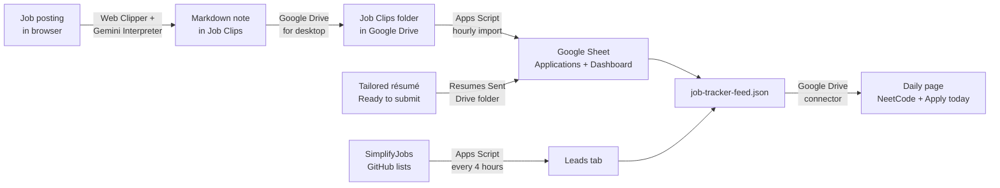

# Obsidian Job Tracker

Clip a job posting with Obsidian Web Clipper, and it becomes a row in a shared Google Sheet: company, title, location, skills, salary and more, pulled out of the posting automatically. The same sheet pulls fresh new-grad and internship leads every few hours, links each application to the résumé that was sent, and feeds a daily practice page that pairs NeetCode problems with an application goal. Built so two or more friends can track their job hunts in one place.

## How it works



1. **Clip.** A custom Web Clipper template asks an LLM (Google Gemini, via the clipper's Interpreter) to read the posting and fill in structured properties: company, job title, category, location, work arrangement, employment type, skills, salary, experience and education. The note is saved to a dedicated `Job Clips` folder with `tracker: job` in its properties.
2. **Sync.** Google Drive for desktop syncs the `Job Clips` folder to Google Drive.
3. **Import.** Every hour (or from the menu), an Apps Script reads each person's synced folder, parses the note properties (YAML front matter), cleans the values, skips duplicates, and adds one row per new application.
4. **Leads.** Every 4 hours the script downloads the SimplifyJobs `listings.json` data files, filters them to fresh, relevant roles in your chosen states, and rewrites the Leads tab.
5. **Résumés.** Each submitted résumé is saved to a "Resumes Sent" Drive folder as `Company - Job Title.pdf`; the script links it to the matching row.
6. **Feed.** The script writes a small JSON file (applied today/this week + top unapplied leads) that a daily practice page reads.

## What uses AI, and what doesn't

| Step                                              | AI?                                                                     |
| ------------------------------------------------- | ----------------------------------------------------------------------- |
| Extracting fields from a posting when you clip it | Yes: Gemini Flash in the clipper                                        |
| Tailoring a résumé                                | Yes: Claude, with a "Ready to submit?" step that saves the approved PDF |
| Import, de-duplication, sorting, résumé linking   | No: plain Apps Script                                                   |
| Leads (download + filter)                         | No: plain Apps Script                                                   |
| Dashboard                                         | No: spreadsheet formulas                                                |

## Features

- **AI extraction.** No copy-pasting; the clipper fills in the fields from the posting.
- **Multiple people.** Each person syncs their own folder; the Settings tab maps each folder to a name.
- **One row per person per job.** Everyone keeps their own application status.
- **Organized automatically.** Rows are grouped by month and sorted by date applied within each month (month computed in the sheet's time zone).
- **Shared-job highlighting.** An "Applied By" column lists everyone who applied to a job (e.g. "Alex & Sam"), and those rows are shaded green.
- **No duplicates.** A job is only added once per person, matched by posting URL (tracking parameters ignored).
- **Dashboard.** Live formulas: totals, interview rate, a per-person team table, applications by month, category and work arrangement, top skills and top locations, plus charts. A filter switches between everyone and one person.
- **Job leads.** New-grad and internship roles posted in the last 2 days from the community-maintained [SimplifyJobs](https://github.com/SimplifyJobs) lists. Filters: open postings, software and AI/ML/data categories, no senior titles, US, your chosen states (East Coast + California by default), remote on/off, New Grad / Internship / Both, and no internships for terms already past. A ☐ Want checkbox keeps a lead on your shortlist; leads you've applied to are marked Applied ✓; unticked leads drop off after 7 days.
- **Résumé archive.** A Resume column links each application to the exact PDF that was sent.
- **Daily page feed.** `job-tracker-feed.json` powers an "Apply today" section (goal progress + top leads) on a separate NeetCode practice page.
- **Automatic refresh.** Free timers (no AI): clips import every hour and leads refresh every 4 hours. Menu buttons run them instantly.

## Repo layout

```
apps-script/JobTracker.gs               Google Apps Script bound to the sheet
clipper/Job_Tracker_Clip_Template.json  Obsidian Web Clipper template
examples/sample-job-note.md             What a clipped job note looks like
docs/screenshots/                       Screenshots (demo data only)
```

## Setup

### 1. Clipper

1. Install [Obsidian Web Clipper](https://obsidian.md/clipper).
2. Settings → open any template → **Import** → choose `clipper/Job_Tracker_Clip_Template.json`.
3. Settings → **Interpreter** → enable it, add a provider (e.g. Google Gemini with a free key from Google AI Studio) and add a Flash model.
4. In Obsidian, create a folder named `Job Clips`. The template saves job clips there.

### 2. Sync to Google Drive

1. Install Google Drive for desktop.
2. Preferences → **My Mac / My Computer** → **Add folder** → select your vault's `Job Clips` folder → **Sync with Google Drive**.

### 3. Google Sheet

1. Create a Google Sheet (or open an existing tracker).
2. **Extensions → Apps Script**, paste `apps-script/JobTracker.gs` into the project's single script file, and save.
3. Choose `setup` from the function dropdown and click **Run**. Approve the permissions (Drive access and connecting to GitHub for the job lists); the "unverified app" warning is expected for your own script.
4. Choose `dailyRun` and click **Run** to fill the Leads tab the first time.
5. Reload the sheet. A **Job Tracker** menu appears, along with Leads, Settings and Dashboard tabs.
6. Fill in **Settings** (see below).

### Settings tab

| Column | What goes there                                      |
| ------ | ---------------------------------------------------- |
| A      | Person's name                                        |
| B      | Google Drive link to their `Job Clips` folder        |
| C      | Last import check (filled by the script)             |
| D      | Google Drive link to their "Resumes Sent" folder     |
| E      | Used by the dashboard filter; leave it               |
| G2     | Lead locations as state codes, e.g. `MA, NY, NJ, CA` |
| H2     | Include remote jobs: `yes` or `no`                   |
| I2     | Lead types: `Both`, `New Grad` or `Internship`       |

### 4. Adding a friend

1. They do steps 1 and 2 with their own accounts.
2. They share their `Job Clips` Drive folder with the sheet owner (Viewer is enough).
3. The owner adds their name and folder link on Settings and shares the sheet with them (Editor).

### Feed file (optional)

`FEED_FILE_ID` in the script points at the Drive file the daily page reads. If you set this up yourself, create a plain-text file named `job-tracker-feed.json` in My Drive and put its ID there; otherwise the script creates one by name.

## Usage

| Menu item                | When to use it                                                                             |
| ------------------------ | ------------------------------------------------------------------------------------------ |
| **Import new clips now** | Right after clipping, if you don't want to wait for the hourly import.                     |
| **Sort & tidy now**      | After typing or editing rows by hand.                                                      |
| **Refresh job leads**    | After changing the lead settings; also runs every 4 hours.                                 |
| **Run setup**            | First time, or after updating the script. Rebuilds the dashboard; doesn't touch your data. |

Daily routine: do the day's NeetCode problems, tick a few leads, then for each one clip it, tailor the résumé (save it with "Ready to submit"), and apply. Update **Application Status** to Interview or Rejected as you hear back.

## Testing

The pure helper functions in `apps-script/JobTracker.gs` (front-matter parsing, value cleaning, URL keys, row building, title matching, lead filters) have unit tests that run on Node's built-in test runner. They need Node 18+ and have no dependencies.

```sh
npm test
```

The tests load the script unchanged with `node:vm`. They don't cover anything that uses Google services (Sheets, Drive, UrlFetch, triggers); check those by hand in the sheet. The tests also run on GitHub Actions on every push and pull request.

## Limitations

- **Free AI tier.** Gemini's free tier has daily request limits that Google can change. Free-tier prompts may be used by Google to improve its products; only public job postings are sent, never the résumé.
- **Some sites hide the job description** from the clipper (e.g. some Phenom-hosted career sites). Those rows get a note to fill in by hand.
- **Drive for desktop is required.** The Apps Script runs in Google's cloud and can only read files in Google Drive.
- **Lead data depends on SimplifyJobs.** If the repos change their data format, the Leads import may need an update. Leads only carry title, company, location and link; clip a lead to get the full posting.
- **Same job, different months.** If two people apply in different months, their rows land in different month groups (both still show "Applied By").
- **Apps Script + multiple Google accounts.** The script editor can fail to open when several Google accounts are signed in; use a single account or a private window for setup.

## Built with

Obsidian Web Clipper · Google Gemini API · Google Drive for desktop · Google Apps Script · Google Sheets · SimplifyJobs listings data

Developed with AI assistance (Claude).
