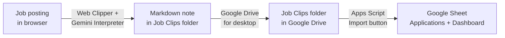

# Obsidian Job Tracker

Clip a job posting with Obsidian Web Clipper, and it becomes a row in a shared Google Sheet: company, title, location, skills, salary and more, pulled out of the posting automatically. Built so two or more friends can track their job hunts in one place and see which jobs they've both applied to.

## How it works



1. **Clip.** A custom Web Clipper template asks an LLM (Google Gemini, via the clipper's Interpreter) to read the posting and fill in structured properties: company, job title, category, location, work arrangement, employment type, skills, salary, experience and education. The note is saved to a dedicated `Job Clips` folder with `tracker: job` in its properties.
2. **Sync.** Google Drive for desktop syncs the `Job Clips` folder to Google Drive.
3. **Import.** In the Google Sheet, **Job Tracker → Import new clips now** runs an Apps Script that reads each person's synced folder, parses the note properties, and adds one row per new application.

## Features

- **AI extraction.** No copy-pasting; the clipper fills in the fields from the posting.
- **Multiple people.** Each person syncs their own folder; the Settings tab maps each folder to a name.
- **One row per person per job.** Everyone keeps their own application status.
- **Organized automatically.** Rows are sorted by month, then company, so when two people apply to the same job their rows sit together.
- **Shared-job highlighting.** An "Applied By" column lists everyone who applied to a job (e.g. "Alex & Sam"), and those rows are shaded green.
- **No duplicates.** A job is only added once per person, matched by posting URL (tracking parameters ignored).
- **Dashboard.** Live formulas: totals, interview rate, a per-person team table, applications by month, category and work arrangement, top skills and top locations, plus charts. A filter switches between everyone and one person.
- **Manual import.** Nothing runs on a timer; imports happen only when you click the button.

## Repo layout

```
apps-script/JobTracker.gs               Google Apps Script bound to the sheet
clipper/Job_Tracker_Clip_Template.json  Obsidian Web Clipper template
examples/sample-job-note.md             What a clipped job note looks like
docs/screenshots/                       Screenshots (demo data only)
```

## Setup

### 1. Clipper

1. Install [Obsidian Web Clipper](https://obsidian.md/clipper).
2. Settings → open any template → **Import** → choose `clipper/Job_Tracker_Clip_Template.json`.
3. Settings → **Interpreter** → enable it, add a provider (e.g. Google Gemini with a free key from Google AI Studio) and add a Flash model.
4. In Obsidian, create a folder named `Job Clips`. The template saves job clips there.

### 2. Sync to Google Drive

1. Install Google Drive for desktop.
2. Preferences → **My Mac / My Computer** → **Add folder** → select your vault's `Job Clips` folder → **Sync with Google Drive**.

### 3. Google Sheet

1. Create a Google Sheet (or open an existing tracker).
2. **Extensions → Apps Script**, paste `apps-script/JobTracker.gs`, and save.
3. Choose `setup` from the function dropdown and click **Run**. Approve the permissions; the "unverified app" warning is expected for your own script.
4. Reload the sheet. A **Job Tracker** menu appears, along with Settings and Dashboard tabs.
5. On **Settings**, enter each person's name and the Google Drive link to their `Job Clips` folder.

### 4. Adding a friend

1. They do steps 1 and 2 with their own accounts.
2. They share their `Job Clips` Drive folder with the sheet owner (Viewer is enough).
3. The owner adds their name and folder link on Settings and shares the sheet with them (Editor).

## Usage

| Menu item                | When to use it                                                                             |
| ------------------------ | ------------------------------------------------------------------------------------------ |
| **Import new clips now** | After clipping jobs. Adds new rows and re-sorts.                                           |
| **Sort & tidy now**      | After typing or editing rows by hand.                                                      |
| **Run setup**            | First time, or after updating the script. Rebuilds the dashboard; doesn't touch your data. |

Update a job's status by changing **Application Status** to Interview or Rejected; the dashboard updates on its own.

## Limitations

- **Free AI tier.** Gemini's free tier has daily request limits that Google can change. Free-tier prompts may be used by Google to improve its products, so don't clip anything sensitive.
- **Some sites hide the job description** from the clipper (e.g. some Phenom-hosted career sites). Those rows get a note to fill in by hand.
- **Drive for desktop is required.** The Apps Script runs in Google's cloud and can only read files in Google Drive.
- **Same job, different months.** If two people apply in different months, their rows land in different month groups (both still show "Applied By").
- **Apps Script + multiple Google accounts.** The script editor can fail to open when several Google accounts are signed in; use a single account or a private window for setup.

## Built with

Obsidian Web Clipper · Google Gemini API · Google Drive for desktop · Google Apps Script · Google Sheets
